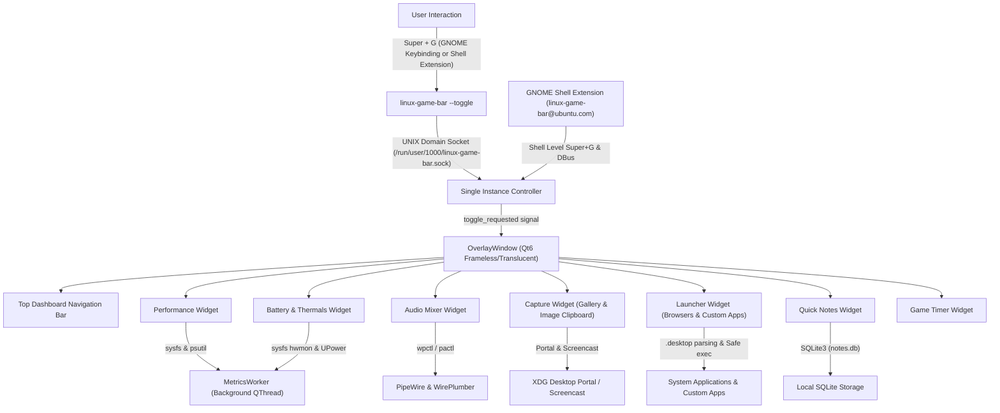

# Architecture: Project Linux Game Bar

## 1. Overview & High-Level Architecture

**Project Linux Game Bar** is a modular, high-performance gaming dashboard for Ubuntu GNOME inspired by the Windows Xbox Game Bar (`Super + G`). It is built using Python 3 and PySide6 / Qt 6, communicating directly with native Linux kernel interfaces, D-Bus services, and desktop portals.

---

## 2. Hybrid Shell & Application Architecture

On modern GNOME Wayland (GNOME 45–51), exclusive full-screen applications and compositor-level input routing present unique isolation challenges. Project Linux Game Bar resolves this using a **hybrid architecture**:

1. **GNOME Shell Extension (`packaging/extension/linux-game-bar@ubuntu.com/`)**:
   - Runs in the GNOME Shell (Mutter) compositor context.
   - Provides compositor-level global shortcut handling and exports `org.gnome.Shell.Extensions.LinuxGameBar` on the session D-Bus.
   - Forwards shell activation events directly to the Python daemon.

2. **Native GSettings Media-Keys Fallback**:
   - Registers `<Super>g` directly into `org.gnome.settings-daemon.plugins.media-keys.custom-keybinding`.
   - Guarantees immediate zero-restart operation on any Ubuntu GNOME session.

3. **Core Python/PySide6 Application**:
   - Hosts all complex UI widgets, hardware monitoring, PipeWire audio, and notes databases in user space without requiring root privileges or destabilizing the compositor.
   - Independent of the active underlying window (no OCR, no window scraping, independent overlay state).

---

## 2. Platform Integration & Single-Instance IPC

### GNOME Shortcut Registration
- Registered directly in GNOME GSettings under `org.gnome.settings-daemon.plugins.media-keys.custom-keybinding`.
- Points to `/home/goutham/.local/bin/linux-game-bar --toggle`.
- Preserves existing custom keybindings and creates automatic backup files in `~/.config/linux-game-bar/shortcut_backup.json`.
- Safely unregisters and restores previous shortcut settings upon uninstallation.

### Single-Instance Local IPC
- Implemented using Qt's asynchronous `QLocalServer` / `QLocalSocket` bound to `$XDG_RUNTIME_DIR/linux-game-bar.sock`.
- When `linux-game-bar --toggle` is called via `Super + G`:
  1. The client probes the local socket.
  2. If an active daemon is running, it transmits the `toggle` command and exits cleanly.
  3. The server instance receives the command in its main event loop and toggles the `OverlayWindow`.
  4. If no instance is active, the invocation initializes the daemon.

---

## 3. Telemetry & Metrics Service

The `MetricsWorker` runs in a dedicated background `QThread` to ensure the Qt UI remains completely fluid and never stutters during gaming:
- **CPU Sampling**: Uses non-blocking `psutil.cpu_percent(interval=None)` with rolling deque history buffers for smooth sparkline graphs.
- **Intel Iris Xe GPU Telemetry**: Directly reads Linux kernel DRM sysfs interfaces at `/sys/class/drm/card1/gt_act_freq_mhz`, `gt_cur_freq_mhz`, `gt_min_freq_mhz`, and `gt_max_freq_mhz` (scaling between 100 MHz and 1500 MHz).
- **Thermals & Fans**: Reads `coretemp` package temperatures, per-core temps, and `dell_ddv` fan RPM.
- **Battery**: Queries UPower and sysfs power supply status for charge state and percent.

---

## 4. Audio Architecture

- Uses `AudioBackend` prioritizing modern PipeWire via `wpctl` (`wpctl status`, `wpctl get-volume`, `wpctl set-volume`, `wpctl set-mute`).
- Falls back to `pactl` when PulseAudio emulation is used.
- Commands are executed with sanitized parameter lists without shell interpolation, eliminating command injection vulnerabilities.

---

## 5. Capture & Recording Architecture

- **Screenshots**: Integrated with `org.freedesktop.portal.Screenshot` and fallback tools (`grim`, `gnome-screenshot`). Supports interactive cropping/selection as well as fullscreen captures.
- **Screen Recording**: Uses native GNOME Shell D-Bus interface `org.gnome.Shell.Screencast.Screencast` and `StopScreencast`, producing high-efficiency MP4/WebM video captures without external dependencies on GNOME Wayland. Falls back to FFmpeg on X11.

---

## 6. Persistence & User Data

Follows the XDG Base Directory specification:
- **Configuration**: `~/.config/linux-game-bar/settings.json` (atomic saving via `.tmp` swap).
- **User Data & Notes**: `~/.local/share/linux-game-bar/notes.db` (SQLite3).
- **Logs**: `~/.local/state/linux-game-bar/linux-game-bar.log` (rotating file handler, 5 MB limit, 3 backups).
- **Runtime IPC Socket**: `$XDG_RUNTIME_DIR/linux-game-bar.sock`.
